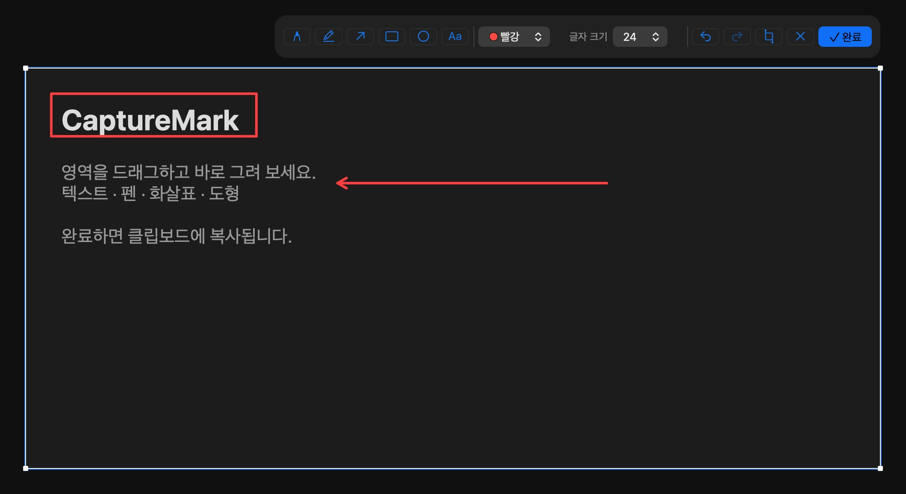

# CaptureMark

화면을 캡처해 설명을 덧붙이고 싶은 Mac 사용자를 위한 앱입니다. 영역 선택부터 텍스트·그림 추가, 클립보드 복사까지 한 번에 처리합니다.

## 소개



앱의 **도구 미리보기**에서 예시 화면을 선택하고 사각형·화살표를 추가한 모습입니다.

펜, 형광펜, 화살표, 도형, 텍스트로 캡처에 표시를 추가할 수 있습니다. 결과는 클립보드에 복사해 문서나 메시지에 붙여넣습니다. 화면과 주석은 Mac 안에서 처리하며 파일로 자동 저장하지 않습니다.

## 시작하기

### 준비 사항

- macOS 14 이상
- Xcode Command Line Tools
- Python 3

개발자 계정이나 인증서 없이 빌드할 수 있습니다. 현재 Mac의 아키텍처로 빌드하며, 실제 검증 환경은 Apple Silicon과 macOS 27.0.1입니다.

### 빌드 및 실행

프로젝트 폴더에서 실행합니다.

```sh
./scripts/build.sh
open dist/CaptureMark.app
```

첫 캡처 시 macOS가 요청하는 화면 기록 권한을 허용하세요. 재빌드 후 권한 오류가 발생하면 시스템 설정의 화면 기록 목록에서 기존 앱을 제거하고 새 앱을 추가한 뒤 재실행하세요.

## 사용법

1. **⌘⇧2** 또는 메뉴 막대의 **새 캡처**를 선택합니다. 시작 창의 **캡처 시작** 버튼도 사용할 수 있습니다.
2. 원하는 화면 영역을 드래그합니다.
3. 펜(P), 형광펜(H), 화살표(A), 사각형(R), 원(O), 텍스트(T)로 표시를 추가합니다.
4. **완료** 또는 **⌘↩**로 이미지를 복사한 뒤 원하는 곳에 붙여넣습니다. **Esc**로 취소합니다.

- 텍스트 입력: Enter로 확정, Shift+Enter로 줄바꿈. 입력 중 ⌘C는 텍스트 복사입니다.
- 실행 취소·다시 실행: ⌘Z / ⌘⇧Z.
- 도형을 그릴 때 Shift를 누르면 정사각형·원·45도 방향에 맞춥니다.
- 여러 모니터를 지원하며, 한 번에 한 모니터 안의 영역을 선택합니다.

### 개인정보와 주의 사항

- 캡처를 서버로 전송하거나 오디오를 녹음하지 않습니다.
- 완료한 이미지는 이 Mac에서만 복사되도록 설정합니다. 클립보드 관리 앱에는 보관하지 않도록 요청하지만, 해당 앱의 동작까지 보장하지는 않습니다.
- 텍스트 입력 중 복사·붙여넣기는 macOS 기본 동작이며, 시스템 설정에 따라 다른 기기에 동기화될 수 있습니다.
- 형광펜이나 테두리는 민감정보를 가리는 도구가 아닙니다.

## 개발

소스는 `Sources/`에 있습니다. 빌드 후 아래 명령으로 렌더링·클립보드·샌드박스 검사를 실행합니다.

```sh
./scripts/test.sh
```

## 라이선스

[MIT](LICENSE)
